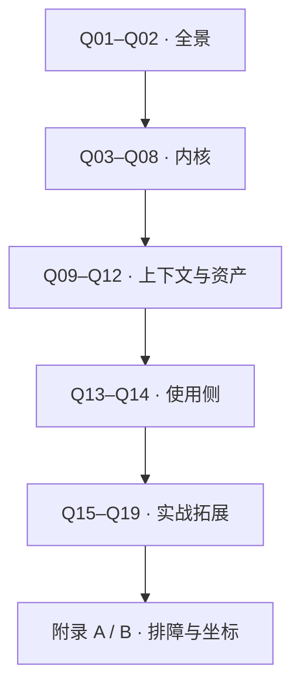

<div align="center">

# Qwen Code 源码级教程

**对着 1.0.0-preview 真源码，逐行读透一个 58 万行的产品级 Harness**

<sub>上游仍在快速迭代；本书钉在 <code>1.0.0-preview @ 2026-11-12</code> 这份快照上，文中行号与数字只对这一份有效</sub>

<sub>21 篇 · 35,340 字 · 1,959 行代码 · 213 个代码块 · 约 8 小时读完</sub>

<br>

[](https://daniel-csvw.github.io/qwen-code-book/)

[](https://daniel-csvw.github.io/qwen-code-book/)
[](https://daniel-csvw.github.io/qwen-code-book/)
[](https://daniel-csvw.github.io/qwen-code-book/)
[](https://daniel-csvw.github.io/qwen-code-book/)
[](https://github.com/QwenLM/qwen-code)

**[马上开始读 →](https://daniel-csvw.github.io/qwen-code-book/)**

</div>

---

## 这是什么

一个 Agent 的循环，教科书版本只有两行：

```ts
while (true) { await callModel(); await runTools(); }
```

Qwen Code 1.0 Preview 选了反方向。它的 `agent-loop.ts` 只有 **86 行**——真正干活的是一条事件总线，
和三个互不引用的 handler：一个管模型、一个管对话、一个管工具。谁先谁后不靠 `if`，靠事件名。

2,541 个源文件、584,003 行 TypeScript（`core` 33 万、`cli` 23 万）。
这套教程只做一件事：**把这个 58 万行的产品级 Harness 拆开，指着源码讲清楚每一层为什么这么写。**

- 每一处论断都带 `文件:行号` 坐标，全书 **338 处**，`npm run fact-check` 一次校验完
- 每一段代码都能整块复制，每个「预期输出」都有脚本对账（`npm run expected`）
- 不是 API 速查，不是概念综述，是**可以照着复现**的阅读笔记

<div align="center">

### [daniel-csvw.github.io/qwen-code-book](https://daniel-csvw.github.io/qwen-code-book/)

</div>

---

## 你会读到什么

| 主题 | 你会拿到的答案 |
| --- | --- |
| 全景 | Qoder × Qwen 合并意味着什么，4 个包怎么分工、7 个入口各通向哪 |
| 入口与总线 | 86 行的 `query()` 怎么起转，`deliver()` 的串行链为什么是排查第一现场 |
| 对话与回合 | 五个 handler 接力跑完一次请求，回合上限、`stop_hook` 与终止条件 |
| 请求装配 | 1,132 行的 `request-preparation.ts` 里，七步到底装配了什么 |
| 消息协议 | 七种消息怎么投影成一次 API 请求，`ensureToolResultPairing` 在修什么 |
| 工具与 MCP | 45 个内置工具怎么接进同一张表，注册表四层缓存为何物 |
| 权限与钩子 | 两道闸门（permission、hook）如何拦住一次工具调用，优先级怎么排 |
| 上下文工程 | 三层记忆、附件生成、并发飞行：prompt 缓存命中率是怎么被保住的 |
| 记忆压缩 | 14 种失败原因、一道不落盘的熔断器，压缩后谁被改写 |
| 技能与插件 | 「能执行 shell 的提示词」是怎么被加载、激活与校验的 |
| Agent 与 Workflow | 六种终止模式、四个内置代理、子代理的隔离边界在哪 |
| ACP 与 headless | 同一个内核怎么接进编辑器和 CI 脚本，事件怎么投影出去 |
| TUI 与 ink | 为什么要把渲染库 fork 进来，`render-node-to-output` 与增量输出 |
| 实战五章（Q15–Q19） | 自定义工具 / 钩子 / 技能 / MCP 服务器 / headless 流水线，写→装→跑→验 |

---

## 章节目录

全部可在线读，点标题直接跳转。

### Part A · 全景

| # | 章节 | 篇幅 |
| --- | --- | --- |
| Q01 | [开篇 —— Qoder 与 Qwen 合并后，这 58 万行在做什么](https://daniel-csvw.github.io/qwen-code-book/modules/q01-overview.html) | 2,127 字 · 62 行 |
| Q02 | [仓库地图 —— 4 个包、55 个目录、7 个入口](https://daniel-csvw.github.io/qwen-code-book/modules/q02-repo-map.html) | 1,632 字 · 69 行 |

### Part B · 内核

| # | 章节 | 篇幅 |
| --- | --- | --- |
| Q03 | [86 行入口与事件总线 —— 三个 handler 如何接力](https://daniel-csvw.github.io/qwen-code-book/modules/q03-query-eventbus.html) | 3,016 字 · 261 行 |
| Q04 | [对话与回合 —— 一次请求如何被五个 handler 接力跑完](https://daniel-csvw.github.io/qwen-code-book/modules/q04-turn-control.html) | 2,097 字 · 177 行 |
| Q05 | [一次请求的七步装配 —— 1,132 行里发生了什么](https://daniel-csvw.github.io/qwen-code-book/modules/q05-request-prep.html) | 1,948 字 · 174 行 |
| Q06 | [消息协议 —— 七种消息如何投影成一次请求](https://daniel-csvw.github.io/qwen-code-book/modules/q06-message-protocol.html) | 1,674 字 · 84 行 |
| Q07 | [工具与 MCP —— 45 个内置工具如何接进同一张表](https://daniel-csvw.github.io/qwen-code-book/modules/q07-tools-mcp.html) | 1,841 字 · 106 行 |
| Q08 | [权限与钩子 —— 两道闸门如何拦住一次工具调用](https://daniel-csvw.github.io/qwen-code-book/modules/q08-permission-hooks.html) | 1,574 字 · 81 行 |

### Part C · 上下文与资产

| # | 章节 | 篇幅 |
| --- | --- | --- |
| Q09 | [上下文工程 —— 三层记忆与并发飞行](https://daniel-csvw.github.io/qwen-code-book/modules/q09-context-engineering.html) | 1,567 字 · 122 行 |
| Q10 | [记忆压缩 —— 14 种失败原因与一道熔断](https://daniel-csvw.github.io/qwen-code-book/modules/q10-compaction.html) | 1,651 字 · 108 行 |
| Q11 | [技能与插件 —— 能执行 shell 的提示词](https://daniel-csvw.github.io/qwen-code-book/modules/q11-skills-plugins.html) | 1,494 字 · 119 行 |
| Q12 | [Agent 与 Workflow —— 六种终止模式与四个内置代理](https://daniel-csvw.github.io/qwen-code-book/modules/q12-agents-workflow.html) | 1,597 字 · 24 行 |

### Part D · 使用侧

| # | 章节 | 篇幅 |
| --- | --- | --- |
| Q13 | [ACP 与 headless —— 内核怎么接进编辑器与脚本](https://daniel-csvw.github.io/qwen-code-book/modules/q13-frameworks.html) | 1,412 字 · 69 行 |
| Q14 | [TUI 与 ink —— 为什么要把渲染库 fork 进来](https://daniel-csvw.github.io/qwen-code-book/modules/q14-ink-tui.html) | 1,378 字 · 58 行 |

### Part E · 实战拓展

| # | 章节 | 篇幅 |
| --- | --- | --- |
| Q15 | [实战一：写一个自定义工具](https://daniel-csvw.github.io/qwen-code-book/modules/q15-custom-tool.html) | 1,506 字 · 91 行 |
| Q16 | [实战二：写一个钩子——三道拦截](https://daniel-csvw.github.io/qwen-code-book/modules/q16-hooks.html) | 1,495 字 · 34 行 |
| Q17 | [实战三：写一个技能——发版一条龙](https://daniel-csvw.github.io/qwen-code-book/modules/q17-skills.html) | 1,965 字 · 100 行 |
| Q18 | [实战四：写一个 MCP 服务器](https://daniel-csvw.github.io/qwen-code-book/modules/q18-mcp.html) | 2,203 字 · 126 行 |
| Q19 | [实战五：headless 流水线](https://daniel-csvw.github.io/qwen-code-book/modules/q19-headless.html) | 2,139 字 · 94 行 |

### 附录

| # | 章节 | 篇幅 |
| --- | --- | --- |
| 附录 A | [按问题查 —— 现象 → 先看什么 → 去哪章](https://daniel-csvw.github.io/qwen-code-book/modules/q21-appendix-a.html) | 六张排查表，覆盖对话 / 请求 / 工具 / 上下文 / 钩子 / CI |
| 附录 B | [源码坐标总表 —— 129 个文件、209 处坐标](https://daniel-csvw.github.io/qwen-code-book/modules/q20-appendix-b.html) | 按引用次数排序，反查「改这里影响哪几章」 |

---

## 四条阅读路线

| 你有多少时间 | 怎么读 |
| --- | --- |
| 20 分钟 | Q01 → Q03。先看这 58 万行的分工，再看 86 行入口怎么转起来 |
| 半天 | Part A + Part B（Q01–Q08）。吃透内核，够你改一个自己的工具或钩子 |
| 全流程 | Q01 → Q19，再用附录 B 横向复盘坐标，用附录 A 当排障手册 |
| 只为了排查 | 直接翻[附录 A](https://daniel-csvw.github.io/qwen-code-book/modules/q21-appendix-a.html)，按现象定位章节 |



---

## 这个站点本身

纯静态，无框架、无运行时依赖、无构建服务器：

- **零依赖渲染**：一个 `build.mjs` 把 Markdown 编译成自包含 HTML，字体走 Google Fonts，离线自动降级系统字体
- **语法高亮**：自带单遍词法器，行号可钉住（```` ```ts {3,5-7} ````）
- **一键复制**：每个代码块都能整块复制，`file://` 下也有 `execCommand` 退路
- **长文友好**：顶部阅读进度条、右侧本章目录（滚动高亮）、上一章 / 下一章
- **深色模式**：跟随 `localStorage` 记忆，刷新不闪
- **窄屏不破版**：宽表格、长代码行各在自己的滚动容器里，整页永不横向漂移

本仓库是**构建产物**（`index.html` + `modules/*.html` + `styles.css`），只用于 GitHub Pages 托管。
内容源与生成脚本在源工程里，改文章请改 Markdown 后重新构建，不要直接编辑这里的 HTML。

本地预览：

```bash
git clone https://github.com/Daniel-csvw/qwen-code-book.git
cd qwen-code-book
python -m http.server 8000
# 打开 http://localhost:8000
```

## 仓库结构

| 路径 | 内容 |
| --- | --- |
| `index.html` | 站点首页（GitHub Pages 入口） |
| `modules/qNN-*.html` | 21 篇正文（渲染后） |
| `styles.css` | 样式与深色模式主题 |
| `content/modules/qNN-*.md` | 21 篇 Markdown 源文件（带 frontmatter） |
| `examples/check/*.mjs` | 20 个章节验证脚本 |
| `examples/check-expected.mjs` | 正文「预期输出」与脚本实测的对账脚本 |

---

## 自己验证这本书

本书的每个数字都应该能被复现。把上游源码快照放在与本书同级的位置，
即 `<repo>/sources/qwen-code-1.0.0-preview/`，然后从仓库根运行：

```bash
# 校验第一章的可数事实：core/src 有几个顶层目录、几个 utils 文件
node examples/check/01-core-dirs.mjs
node examples/check/00-utils-count.mjs

# 对账：正文写的「预期输出」是否与脚本实测一致
node examples/check-expected.mjs
```

全部 20 个脚本都可以这样单独跑，每个只输出**可数事实**，不需要安装任何依赖。
脚本按自身位置解析根目录，任意工作目录均可运行。

获取上游快照：

```bash
git clone --depth 1 --branch v1.0.0-preview \
  https://github.com/QwenLM/qwen-code.git
```

---

## 版本与范围

- 阅读对象：**Qwen Code v1.0.0-preview**（[QwenLM/qwen-code](https://github.com/QwenLM/qwen-code)），2,541 个源文件 / 584,003 行 TypeScript
- 覆盖 4 个包的主要运行时路径；未展开的部分会在章节里注明「这里没展开」
- 快照固定为 `1.0.0-preview @ 2026-11-12`。Preview 接口会变，行号也会漂——
  对不上时按**函数名**搜，不要按行号
- 许可：教程内容 **CC BY-NC-SA 4.0**；引用的源码归 Qwen Team 与 Google LLC，Apache-2.0

---

## 作者

**Daniel**

邮件：[luhui215@hotmail.com](mailto:luhui215@hotmail.com)
站点：<https://daniel-csvw.github.io/qwen-code-book/>

## 致谢

- [QwenLM/qwen-code](https://github.com/QwenLM/qwen-code) —— 全书读的就是它，所有代码片段、行号与设计都来自这份快照源码本身
- [dg-ai-notes](https://dg-ai-notes.pages.dev/) —— 双轨教程的内容组织与站点版式参考
- 同系列：[Pi Agent 源码级教程](https://daniel-csvw.github.io/pi-agent-book/)（23 万行，27 篇）—— 两本书可以交叉读：一个把循环写成状态机，一个把循环拆成事件总线

<div align="center">
<sub>如果这套笔记帮你少踩了一个坑，点个 Star 就是最好的反馈。</sub>
</div>
